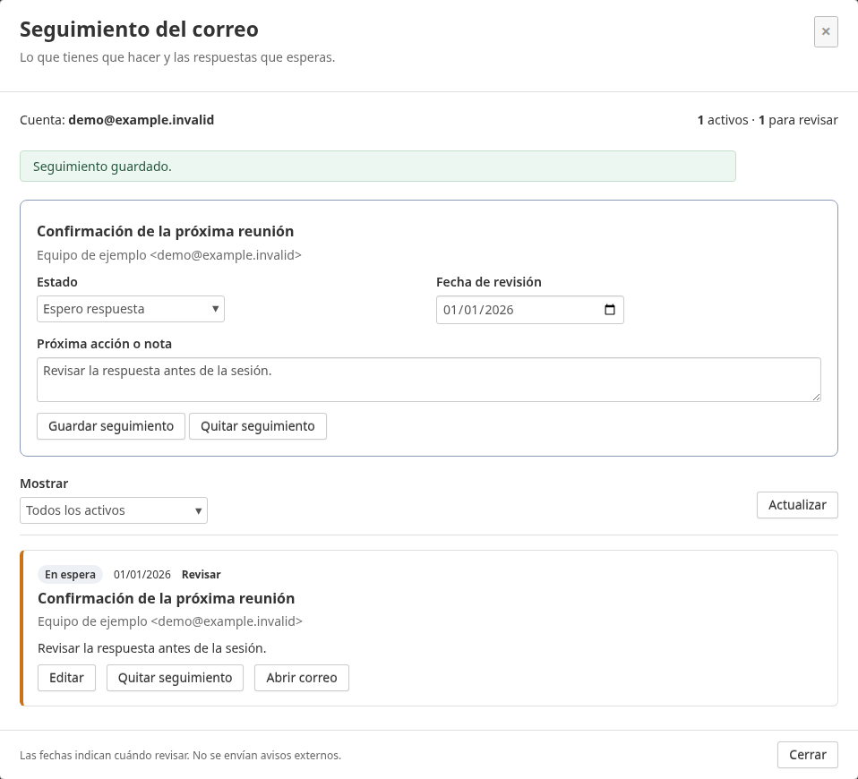
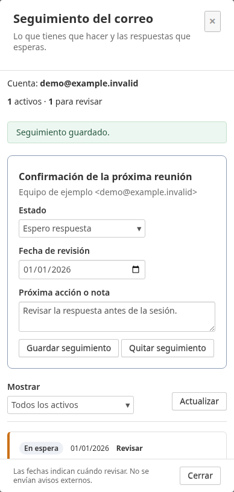

# Seguimiento / Mail follow-ups for SnappyMail

A standalone SnappyMail plugin for keeping track of messages you need to answer,
replies you are waiting for, review dates and short notes. No core modifications.
Developed and tested against **SnappyMail 2.38.2**. AGPL-3.0.

The current interface is **Spanish**. This is manual follow-up tracking for the
active account; it does not detect replies or send notifications. It works
independently of [Unified Inbox](https://github.com/sasogu/snappymail-plugin-unified-inbox).

## Install

1. Download the installable ZIP from [Releases](https://github.com/sasogu/snappymail-plugin-seguimiento/releases).
2. Extract it into your SnappyMail data directory under
   `_data_/_default_/plugins/`, preserving the directory name **seguimiento**.
   The resulting path must be `plugins/seguimiento/index.php`.
3. Ensure PHP has **PDO SQLite** (`pdo_sqlite`) and **mbstring** enabled.
4. Enable plugins and **Seguimiento** in SnappyMail administration, then reload
   the webmail page.

The PHP process needs write access to its private data directory. The default
database is `APP_PRIVATE_DATA/seguimiento/seguimiento.sqlite`. You can set the
PHP environment variable `SEGUIMIENTO_DB` to an absolute database path outside
public/static directories. Back up the database separately from the plugin.
Existing private installations with a custom database location should keep that
location through `SEGUIMIENTO_DB` when adopting this standalone distribution.

## Use

- Open a message and click **Seguimiento** below its header.
- Choose **Tengo que responder** (need to reply), **Espero respuesta** (waiting
  for a reply), or **Resuelto** (done). Optionally add a review date and note.
- Click **Guardar seguimiento** to save.
- Open **Seguimiento** from the folder sidebar to filter active, waiting, resolved
  or due items. Edit an item, open its email, or remove its follow-up.

**Quitar seguimiento** beside **Editar** removes a follow-up directly from the list.
Removing a follow-up keeps the email. Opening a message uses SnappyMail's normal
read behavior. The plugin locates it by Message-ID in its recorded folder;
if it was moved, find it in SnappyMail and save its follow-up again. Messages
without a valid Message-ID cannot be tracked. Due dates are review dates, not
email delivery schedules. They are recalculated when opening/refreshing the
panel; no cron job is required.

Follow-ups are isolated by the authenticated main user and active account.
They do not appear in other IMAP clients and are not synchronized through IMAP
flags. There is no all-account follow-up view or automatic reply detection.

The database stores message identifiers, folder/UID, sender, subject, status,
review date and note, with no bodies or credentials. It uses directory mode 0700
when creating directories and database file mode 0600. Keep this private metadata
out of public serving and unencrypted backups. The plugin respects SnappyMail's
global logging configuration; request/debug logging can expose notes and mail
metadata, so disable it in production when handling private mail.

The stored overdue indicator defaults to the **Europe/Madrid** timezone. Override
it with `SEGUIMIENTO_TIMEZONE` (an IANA timezone name) if needed. Displayed review
filters follow the browser's local date, so a browser in another timezone may
differ around midnight.

## Español

Plugin independiente para gestionar **correos por responder**, **respuestas en
espera**, **fechas de revisión** y **notas**. La interfaz está en español.

Descomprime el ZIP de la publicación en la carpeta de plugins de SnappyMail,
conservando el nombre `seguimiento`, y actívalo desde administración. Requiere
PHP con PDO SQLite y mbstring. Abre un correo, pulsa **Seguimiento**, elige su
estado y guarda. El botón de la barra lateral muestra los seguimientos de la
cuenta activa y permite filtrar, editar, abrir el correo o retirar su marca.

Los datos se guardan en el directorio privado de SnappyMail, separados por
usuario principal y cuenta. Quitar un seguimiento conserva el correo. No envía
avisos, no detecta respuestas y no requiere tareas programadas. Consulta las
opciones de almacenamiento y zona horaria anteriores al instalarlo.

## Development

```sh
php -l index.php
php tests/store.php
php tests/backend.php
node --check seguimiento.js
node tests/ui.cjs
python3 tests/demo.py
```

The demo test requires Playwright, Chromium at `/usr/bin/chromium` and a running
SnappyMail installation. Set `SEGUIMIENTO_DEMO_URL` (default
`http://127.0.0.1:8100/`). It does not log in: RPC calls use synthetic data and
screenshots contain fictitious messages only. No mail is sent, opened or changed.

For an opt-in live integration check, set `SEGUIMIENTO_URL`,
`SEGUIMIENTO_EMAIL` and `SEGUIMIENTO_PASSWORD_FILE` (a protected file whose first
line contains the existing app password), then run `python3 tests/browser.py`.
It creates temporary synthetic follow-ups, exercises direct removal from the
list on desktop/mobile and cleans up. It does not open or modify messages,
save screenshots, or log private response data.

See [verification](docs/VERIFICATION.md) and [changelog](CHANGELOG.md).




